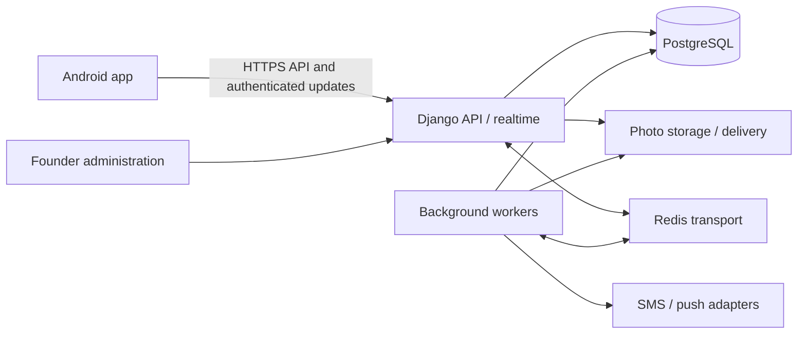

# AskIT production launch design

Date: 7 October 2026 · Owner: founder · Status: written design awaiting review.

## 1. Purpose and decision status

AskIT helps people get local work done, helps providers find work and earn, and supports a local community. Seekers and providers are both customers. Hiring and earning carry more weight than community growth. The founder wants faster, easier development and a useful production-ready app launched as soon as it is ready.

The approved conversational design is recorded in [questions 1–39](launch-planning-qa.md). This document consolidates it and supplies concrete **proposed implementation defaults** for previously open details. Approval of the conversation did not approve these new defaults. Written-design approval is the next checkpoint; implementation planning follows it.

The first release is a free, small invited pilot in **Pondicherry**. Recruitment and promotion focus on home services, while other supported categories can register, participate, publish services, and hire. There is no fixed launch date, committed participant count, operating budget, or demonstrated user-capacity guarantee.

**Controlling provider rule:** providers can publish listings, respond to tasks, and accept jobs without manual review. Review earns a badge only. This replaces the earlier approval-before-work requirement. The chosen badge wording is **“Profile reviewed,”** based on phone verification, profile/service details, and available work examples.

The [correction-document comparison](correction-reference-review.md) is reference material. Its five call slots, 30-minute missed-call rule, subscription scoring, and other unselected suggestions are not requirements.

The [audit](production-readiness-audit.md) remains **NO-GO**. This document is a design, not evidence that the app or backend works in production.

## 2. Launch scope

| Area | Required pilot behavior |
| --- | --- |
| Accounts | Verified-phone sign-in, durable signup/profile edits, one account able to seek and provide, session recovery, account deletion |
| Services | Durable listings, photos, category/area discovery, provider profiles, optional manually reviewed badge |
| Hiring | Browse and request a provider; post a task with Direct Call and Show interest; both price-agreement routes; shared booking, cancellation, completion, and reciprocal reviews |
| Community | Local public feed; text/photo posts, questions, polls, comments, likes, provider recommendations, before/after photos |
| Stories | Text, photos, and polls; 24-hour visibility; polls close with the story |
| Messaging | One-to-one text/photo conversations; one text-only introduction before recipient acceptance; saved history, unread counts, notifications, reporting/blocking |
| Founder tools | Profile-review queue, reports, support cases, moderation, categories/areas, app configuration, operational visibility |
| Release | English/Tamil, effective privacy controls, durable media/drafts, tested recovery, real-device acceptance, production configuration and signing |

Payments remain direct between participants. AskIT records the agreed price but does not collect payments or assert that a payment succeeded. Phone/WhatsApp remain service-contact options alongside private messaging. A message or phone call does not implicitly book or complete a job.

The initial design does not add subscriptions, group chat, voice/video calling, video publishing/stories, typing indicators, or read receipts. Existing controls outside the selected scope must be hidden or removed from production navigation rather than reporting fake success. Selected launch features must not be silently deferred to meet a date.

## 3. Architecture and boundaries

Keep the existing Kotlin/Compose Android app and design system. Add a custom Django REST Framework backend beside them. Use PostgreSQL for durable records and separate S3-compatible object storage for photos. Deploy one modular backend codebase with separately runnable API/realtime, worker, and scheduler processes.

| Module | Owns | Boundary |
| --- | --- | --- |
| Identity/accounts | Phone challenges, sessions, profile, preferences, deletion | Issues current identity; never accepts a caller-supplied acting account |
| Directory | Categories, areas, listings, review badge | Badge state is independent of listing/job eligibility |
| Hiring | Requests, task responses, agreements, assignment, jobs, reviews | All state changes use authorized transactional actions |
| Community | Posts, questions, comments, reactions, polls, stories | Uses shared media and safety services |
| Messaging | Requests, conversations, messages, unread cursors | Authorizes participants and applies blocks on every send/read |
| Media | Upload authorization, processing, renditions, cleanup | Validates ownership, purpose, and visibility before attachment/delivery |
| Safety/support | Blocks, reports, support cases, moderation actions | Controls safety restrictions and audited founder interventions |
| Delivery/operations | Outbox, notifications, retries, health, metrics | External delivery never substitutes for database commitment |

Module actions are shared by HTTP endpoints and founder tools. Cross-module changes call those actions rather than editing another module's tables directly. PostgreSQL transactions and constraints enforce uniqueness and competing-action rules. Begin with database search/indexes and pagination; introduce extra search services or data partitioning only for measured needs.

### Proposed tooling defaults

Use Python 3.13, Django 5.2 LTS, compatible REST Framework, PostgreSQL, and drf-spectacular for OpenAPI. Pin tested compatible patches during backend setup; record the exact versions in lockfiles. Django's published schedule gives 5.2 LTS extended support through April 2028; maintain an upgrade task before that support ends. [Django support](https://www.djangoproject.com/download/), [Python compatibility](https://docs.djangoproject.com/en/5.2/faq/install/), [schema tooling](https://www.django-rest-framework.org/api-guide/schemas/).

Propose Django Channels for authenticated WebSocket update events and Celery for background work, using separate Redis transport namespaces/instances so their resource policies can differ. Production messaging uses a shared channel layer rather than a process-local layer. PostgreSQL remains authoritative for messages, sessions, jobs, and queued business events. [Channels](https://channels.readthedocs.io/en/stable/introduction.html), [production channel layer](https://channels.readthedocs.io/en/stable/topics/channel_layers.html), [Celery/Django integration](https://docs.celeryq.dev/en/stable/django/first-steps-with-django.html).

Write each external side effect to a transactional outbox alongside its domain change. A dispatcher and reconciliation scan deliver/retry pending work even if Redis or a worker restarts. Workers use bounded exponential retries and an operations-visible failed-work queue. Handlers must tolerate repeated execution; queue acknowledgment settings alone do not prove exactly-once delivery. [Celery task semantics](https://docs.celeryq.dev/en/stable/userguide/tasks.html).

## 4. Detailed defaults proposed for written review

These values resolve open design details. They are proposed, configurable baselines rather than earlier founder answers. Changes to product behavior require an updated decision record.

| Detail | Proposed default |
| --- | --- |
| Pending provider confirmation | No automatic assignment expiry in the pilot; seeker can withdraw, provider can decline, reminders/support remain available |
| Stalled completion | Reminder after 24 hours, once again after 72 hours, then support queue; never automatically complete |
| Contact permission request | One pending request per requester/number owner/task-or-listing; expires after 7 days |
| Granted contact access | Scoped to that requester and task/listing for 30 days, revocable sooner; invalidate on number change, block, or resource removal |
| Private-message request | One introduction, at most 500 characters; expires after 7 days; decline/expiry permits another request after 30 days, unless the recipient initiates sooner |
| Message/content limits | Message text 5,000 characters; post text 5,000; comment/review 2,000; at most 6 photos per post/listing and 1 per message/story |
| Photo validation | At most 10 MiB and 20 megapixels per input; JPEG/PNG/WebP supported through validated decoding; resize and strip location metadata |
| Polls | 2–6 options, one vote per account, mutable until close; feed poll closes after 24 hours, 3 days, or 7 days chosen at publication; story poll closes with its story |
| Reviews | 1–5 whole stars plus optional text; publish immediately after submission; author can edit for 7 days; retain edit/moderation history |
| List APIs | Cursor pagination, 20 items by default and at most 50; additionally limit serialized size to fit the current 64 KiB JSON transport |
| Initial anti-spam controls | At most 10 new private-message requests per account/day; bounded per-account/per-IP writes and media quotas configured separately from task contact-slot quotas |

Apply limits server-side and surface stable localized errors. Tests must show that concurrent requests cannot bypass limits. Identity/SMS-spend and daily-request limits need durable shared counters or safe denial when their authoritative state is unavailable; a Redis restart must not reset them into unlimited access. Anti-spam controls may be adjusted operationally with audit records; they do not establish the reference document's five-provider-slot business rule.

## 5. Accounts, listings, and review badge

Preserve the proposed [auth paths and session contract](auth-backend-contract.md): OTP challenge/verification, refresh rotation, and revoke. Derive identity from the session, keep phone numbers in E.164, consume a challenge once, and enforce server-side expiry/attempt/resend limits. Proposed initial OTP values are six digits, five-minute expiry, 30-second resend wait, and five verification attempts; additional hourly/daily SMS limits and a spend ceiling are part of the production SMS configuration.

Store credentials/challenges securely on the server and never log OTPs, refresh/access tokens, or raw message bodies. Keep the existing Android Keystore/no-backup refresh storage, backend binding, bounded refresh retry, and account-isolation behavior. Concurrent authenticated requests share one refresh operation. The server rejects reuse of a consumed refresh credential. If a rotation response is lost before it can be saved, recover through sign-in rather than repeatedly replaying the consumed credential. A local storage failure after receiving the response retries saving that pending credential before another rotation. Scope revocation to the affected session/family so recovery does not log out unrelated device sessions.

Make signup and edits durable before showing success. Support verified phone changes through a separate verification action; ordinary profile edits cannot change identity or badge status. Returning accounts recover their server profile after restart and on another device. Local sign-out immediately hides private screens and clears account-specific state even when server revocation is temporarily unavailable.

A person can seek and provide from the same account. A listing carries a stable category, title, description, public coverage, work modes, pricing description, availability, optional experience/work examples, and photo references. Seed the existing electrician, plumber, cleaning, AC repair, home tutor, and appliance repair categories plus a proposed Other category with a custom description. Categories and cities are administration-managed data; home services receive promotion without preventing other-category participation.

Unreviewed providers can publish, respond, and accept jobs. Founder review records its checklist, actor, time, result, and reason. Phone ownership, “Profile reviewed,” and completed-job ratings are distinct. Material changes to reviewed phone/name/service-category facts reset the badge for re-review without blocking work. Moderation suspension is a separate safety action with its own reason and audit trail.

Discovery filters by category, chosen area, availability, and searchable profile/listing text. Provider/service details must support a real request action. Public profile projections omit private phones, exact addresses, saved-provider lists, and account settings.

## 6. Contact consent and private task details

Both roles explicitly choose immediate or permission-first contact during signup. Task/service forms inherit the current account preference and allow an explicit override. An item without an override follows subsequent account-preference changes; the form explains that behavior.

Immediate contact authorizes eligible signed-in users to retrieve the number for that task/listing. Permission-first requires a requester-scoped grant. The number owner's preference controls access; a caller's preference, a message-request acceptance, or possession of a task ID cannot override it. Existing grants may be revoked by their owner. Changing to permission-first revokes prior item grants unless the owner explicitly keeps them.

Phone retrieval is a separate authorized endpoint, never part of a public profile/feed/listing projection. Reject access when either account is blocked/suspended or the grant/item is invalid. Avoid persistent client phone caches and invalidate visible numbers when authorization changes. Revoking app access cannot remove a number someone already saw or copied.

Direct Call and Show interest remain available on every eligible task. Where permission is needed, Direct Call requests it first. The UI reports a contact request or dialer handoff; ordinary dialer launch is not evidence of a placed, answered, or missed call. WhatsApp handoff follows the same number-disclosure rule and handles unavailable external apps.

Public tasks expose the chosen public area only. Store exact address and access instructions separately. The seeker and currently assigned provider after booking confirmation can retrieve them. Other respondents, pending selections, former assignees, and unrelated accounts are denied. Access checks and cache invalidation apply to APIs, media, notifications, telemetry, reassignment, logout, and account switching. Preserve the existing [task privacy requirements](task-privacy-handoff.md).

## 7. Hiring and reviews

Browse/request and post-task/respond converge on one job model. A task retains authenticated author ID, work mode, schedule/window, public area, private details, requirements/materials, optional budget, and photos. On-site and remote choices round-trip unchanged. Service requests inherit the selected listing/provider and use the same agreement rules.

Show interest may contain a note and optional priced offer. The seeker sees respondents, profiles, actual ratings, notes, quotes, and selection status in one dashboard. Providers cannot respond to their own tasks. Phone/WhatsApp negotiation can create the same recorded agreement as an in-app offer.

Record scope, INR amount in integer minor units, and schedule/window in a versioned agreement. Listing price descriptions can remain flexible; booking requires a specific agreed amount and schedule/window. Seeker selection confirms that agreement version and creates a pending assignment. Provider confirmation of that same version books the job. Prior interest/quote submission is not assignment confirmation.

| Transition | Authorized action and effect |
| --- | --- |
| Open → assignment pending | Seeker selects one provider and the agreement version; other responses remain available |
| Pending → open | Provider declines or seeker withdraws; preserve history and permit another selection |
| Pending → booked | Selected provider explicitly confirms the current agreement; atomically fill the task and notify other respondents |
| Booked → in progress | Assigned provider marks work started |
| In progress → completion requested | Assigned provider marks work finished |
| Completion requested → completed | Seeker confirms completion in AskIT; enable reciprocal reviews |
| Pending/booked → cancelled | Either participant can cancel before starting, with reason and notification |
| In progress/completion requested → disputed | Either participant opens a support case; completion/review eligibility pauses |

Only one current assignment/booking may exist per task. Database constraints, row/version checks, and idempotency enforce this across concurrent selections, accepts, and retries. Return a conflict for stale actions rather than overwriting newer decisions. Scope/price/schedule changes require a new agreement version and both confirmations; the existing confirmed agreement stays authoritative until the replacement is confirmed.

Keep task availability separate from job history. A pending-selection withdrawal releases that selection; closing a task is a separate seeker action. Cancelling a confirmed booking ends that job and returns the task to open unless the seeker closes it. A replacement booking has its own canonical job/confirmation and preserves the cancelled job's history. A task may therefore have successive cancelled bookings but never multiple active bookings. All dashboards/details use the same canonical job for a given booking.

Founder support can request clarification, record an agreed resolution, or apply a separate moderation restriction. Proposed resolution powers: reopen completion only with both parties' recorded agreement, or cancel the job as disputed with a recorded reason. Founder tools cannot manufacture ordinary seeker completion, self-author reviews, or claim to collect/refund direct payments. Reassignment after a booking requires cancellation of the prior booking and a fresh agreement/confirmation, revoking the former provider's private-details access.

Completed jobs permit one review from each participant about the other. Store job, author, subject, role, rating, text, and history separately; reject self-reviews and unrelated-account reviews. Show role-specific rating aggregates so a provider's service rating does not silently mix in reviews of their behavior as a seeker. Recommendations and before/after posts do not affect these ratings.

Replace the local role switch and job OTP controls with these server-authorized actions. The chosen completion flow uses seeker confirmation, so shipping the demo OTP is unnecessary. Historical audit A05's OTP acceptance criterion is superseded by this agreed completion design.

## 8. Community and stories

Use one publishing foundation for ordinary posts, questions, provider recommendations, and before/after pairs. Public feed discovery focuses on the chosen city/area with newest content first. Location is a discovery filter, not a confidentiality boundary. Do not put precise device/job coordinates in public content automatically.

Questions use comments for replies. Recommendations link a provider's profile and can be published without an AskIT job. Before/after content presents a labelled photo pair with captions. Obtain appropriate permission for other people's photos/private property and provide reporting; these posts never imply verified job completion. If a linked profile is removed, show an unavailable-profile label without exposing deleted personal details.

Likes are unique per account/content item and retry-safe. Comments persist with their real authors and server timestamps. Authors can delete content; moderators can remove it with a recorded reason. Proposed editing allows text/caption corrections with an edited marker, while poll options cannot change after the first vote.

Polls permit one active choice per account, changeable until server closing time. Authors and accounts that voted can see aggregate results; voter identities are not public. Closing a poll rejects later votes even if an expiry worker is delayed. A story becomes unavailable exactly 24 hours after publication, and its poll closes simultaneously. All access paths, including media delivery, enforce expiry.

Stories support text/photo composition and optional polls. Persist the authored composition and render the visible visual layer; poll interaction is a separate server-backed overlay. Retained download/export controls must produce the authored text/photo composition, with poll graphics exported as a static image. Unsupported video controls are outside the selected story scope and must not remain active in the pilot.

## 9. Private messaging

One-to-one conversations belong to stable account IDs. A new sender can submit one text-only introduction into the recipient's requests inbox. Until acceptance, neither sender retries nor another device may create extra messages/photos. The recipient accepts, declines, or blocks. Acceptance creates/activates the shared conversation transactionally; crossed requests must not create duplicate conversations.

Accepted conversations support text and photos. Clients create an idempotent send identifier; the server persists the message before acknowledging success. Show pending, sent, and failed-with-retry states. Sending successfully does not claim recipient delivery or reading. Store per-participant last-seen sequence for unread counts, without exposing read receipts in the pilot.

Use authenticated HTTP for writes and cursor-based history/catch-up. Proposed WebSockets deliver post-commit update hints while the app is active; reconnect performs authorized HTTP catch-up from the last committed cursor. Authenticate socket connections, stop access when the session expires/revokes, and check current blocks/participation before delivering restricted payloads. A socket outage or lost Redis event must not lose a saved message.

Blocking prevents new messages and requests in either direction while either block exists. It also hides the other account's community content from the blocker's feed and prevents new task responses/contact grants between the pair. Existing job records remain available under job permissions; job-state actions and founder support remain usable. Unblocking restores an existing accepted conversation, while expired/declined requests follow the request policy.

Reports can include selected messages and voluntarily submitted context for founder review. Proposed access boundary: routine founder tools can view the reported evidence, not browse arbitrary private conversations. Sensitive operational access requires a documented purpose, restricted role, and audit record. Message photos require participant authorization. The app must not claim end-to-end encryption; this design relies on transport/storage protections and authorized server access.

## 10. Android integration, media, and failure behavior

Preserve existing authenticated-entry protections and design-system components. Introduce one account-scoped repository/session boundary shared by Home, Explore, dashboards, jobs, profiles, and inbox. Remove independent demo stores from production wiring. Dashboards show real aggregates and incoming work from those same records; hide synthetic metrics/insights. Use stable server identities and clear account-specific caches/drafts on sign-out or switching accounts.

Every mutation distinguishes pending, acknowledged success, conflict, and failure. Preserve form input on failure. Reconcile optimistic likes/votes with the server; booking and completion never advance solely on optimistic UI. Offline reading may use authorized account-scoped cached summaries, but private details and revoked data must not remain available through stale navigation. Offline drafts are supported; committing a booking/completion requires the server.

Use upload intents with server-issued IDs, restricted destinations, size/type validation, and ownership/purpose checks. Process photos before publication, strip location metadata, produce thumbnails, and reject malformed/oversized content. Private-message/restricted media require expiring access-controlled delivery; signed URLs alone are bearer access until expiry, so keep expiry short and exclude them from logs. Publicly visible story media still needs expiry-aware delivery. Production upload bodies are separate from bounded JSON responses.

Store drafts durably per account with retained/copied media access. Verify draft restoration after force-stop and recovery from lost URI permission. Uploads show progress, failure, cancellation, and retry; cleanup cannot delete active drafts. Export/download work runs off the UI thread, handles storage denial/low space, and removes incomplete destinations. Validate actual output rather than assuming source-copy equals rendered export.

Use English/Tamil resources for all shipped controls, errors, empty states, dates, and INR amounts. Verify large text, TalkBack, keyboard navigation, and system-bar behavior. Respect the app's location preference as well as Android permission; allow manual area entry without precise location.

Proposed push adapter: Firebase Cloud Messaging for Android delivery, with custom backend records and domain rules remaining authoritative. Persist token registration/unregistration and notification preferences. Request Android notification permission where required. Use generic private-message/contact notifications without phone numbers, addresses, or message bodies; in-app notifications/history remain available when push is denied or delayed. [FCM Android setup](https://firebase.google.com/docs/cloud-messaging/android/get-started).

## 11. Founder operations, deletion, and policies

Administration covers badge review, category/area configuration, reported content/accounts/messages, job support cases, deletion requests, public links, and failed background work. Separate badge revocation, content removal, messaging restriction, and account suspension. Record actor, reason, time, affected object, and previous/new status. Sensitive domain actions must not be bypassed by generic table editing. Require protected staff authentication, least privilege, and staff-session controls.

Propose daily report/support triage during the invited pilot, with urgent safety reports surfaced separately. The founder owns triage and incident response initially. Invitation volume must fit actual support capacity; the app is not an emergency-response service and must not promise an unstaffed response SLA.

Provide account deletion in Settings and a reachable external request resource. Re-authenticate, accept a durable request, revoke all sessions, remove public discovery visibility, and process primary-data/media deletion with status/error feedback. Open jobs generate support work and minimal counterpart notifications rather than silently vanishing or blocking submission of the deletion request. “Clear local data” signs out and removes app-owned caches/drafts; it does not delete remote account data or the user's exported gallery files.

Proposed retention baseline for review: orphaned upload cleanup after 24 hours; deleted content/account data purged from primary storage within 30 days; expired-story assets removed within 7 days; backups expire within 35 days. Surviving participants' messages retain their own content, while deleted-account-authored content is removed/tombstoned. Any job/dispute or abuse evidence exception requires a documented purpose, minimal retained fields, explicit duration, restricted access, and disclosure before production collection. Do not invent a legal retention entitlement or launch with an undefined exception. Restoration must reapply the deletion ledger before serving restored data.

The founder must approve and publish actual privacy, terms, community rules, support, and deletion resources before production invitations. Record acceptance before publishing UGC. Complete store disclosures from the actual app, SDKs, messaging, location/media practices, and retention implementation. These are release inputs; the fallback homepage is insufficient. [Play UGC policy](https://support.google.com/googleplay/android-developer/answer/9876937?hl=en), [account deletion](https://support.google.com/googleplay/android-developer/answer/13327111?hl=en), [user-data policy](https://support.google.com/googleplay/android-developer/answer/10144311?hl=en).

## 12. API, data, and compatibility rules

Maintain versioned OpenAPI alongside domain rules and Android adapters. Preserve existing `/v1/auth/*`, `/v1/me`, and `/v1/app-config` protections, making deliberate contract additions rather than treating the existing sample payloads as a full backend specification.

| Existing contract/model | Required adaptation |
| --- | --- |
| `/v1/me` read-only integration | Add durable signup/profile editing and phone-change actions; keep identity checks and bounded summaries; paginate growing collections separately |
| `isVerified` | Map only to server-managed profile-review badge; never infer it from OTP, provider role, listings, or jobs; use “Profile reviewed” wording |
| `activeRole` | Retain compatible Seeker/Provider/Both values as presentation preference; job permissions come from actual participants |
| `whoCanMessage` legacy options | New conversations always use requests; hide unsupported Contacts-only/Verified-only selectors in the pilot and migrate defaults explicitly |
| Story audience controls | Local public publishing is selected; hide unsupported private/follower-only selectors rather than accepting ineffective values |
| Singular profile listing and embedded history | Keep a compatible primary listing/limited summaries; use paged listing/review/gallery APIs for complete history |
| `/v1/app-config` | Add deletion destination, canonical sharing origin, and supported feature/version metadata; production requires real approved URLs |
| Task/job local IDs and OTP | Replace with server IDs, explicit seeker/provider IDs, agreement versions, and authorized transitions |
| Current 64 KiB JSON transport | Keep it bounded; use feed/search excerpts, detail endpoints, and size-bounded pagination rather than unlimited feed/message/profile responses |

Main API families are accounts/preferences, categories/areas/discovery, listings/review submissions, tasks/responses/contact grants, agreements/jobs/reviews, posts/comments/likes/polls/stories, conversations/requests/messages, uploads, notifications/devices, reports/blocks, and deletion. Endpoint schemas and contract tests must be completed per journey before its Android adapter changes.

Use opaque IDs, UTC timestamps, explicit currency/minor units, stable enums/error codes, immutable authorship, version checks, and idempotency keys scoped to authenticated account/action. Reject unauthorized ownership fields. Return stable validation/conflict/rate-limit errors without leaking raw internal exceptions or account existence through OTP requests.

Important unique constraints include account phone/username, one active assignment per task, one accepted conversation per unordered participant pair, message send identifier per sender, one vote per account/poll, one reaction per account/content, and one review per author/job. Authorization queries and transactional checks must use the same authoritative state as writes.

## 13. Scalability, performance, and recovery

The locked approach supports adding API/realtime/worker instances without moving authoritative state out of local process memory later. Use shared PostgreSQL, separate media delivery, connection budgets, indexed access paths, bounded queries, and compatibility-safe migrations from the beginning. Scale based on measurements; replicas, caching, partitioning, or separating a busy module are later responses to actual bottlenecks.

**Proposed pilot acceptance workload, not a DAU forecast:** seed 1,000 accounts, 2,000 listings, 20,000 community items, and 100,000 messages. Exercise 100 authenticated concurrent clients, 50 API requests/second for 30 minutes, and 100 active messaging sockets, then a five-minute burst at twice the request rate. Include reads, publishing, votes, messages, and competing job actions. Run critical cross-instance scenarios with at least two API processes and two workers.

Proposed targets on the candidate staging infrastructure: p95 ordinary read latency at most 750 ms; write acknowledgment at most 1.5 seconds; unexpected server-error rate below 1%; active message update p95 at most 2 seconds after commit. Measure photo processing and external SMS/push separately. Correctness requirements permit zero unauthorized accesses, duplicate bookings/reviews, or lost acknowledged messages in the exercised scenarios. Record environment, data size, workload, duration, and resource costs with results.

Propose a database recovery-point target of 15 minutes and service recovery within 4 hours for the invited pilot. Select backup/PITR and object-storage recovery capabilities capable of meeting those targets, and demonstrate restoration into an isolated environment. Restore database, media references, access/deletion state, and pending work coherently. If the candidate budget cannot meet targets, present the cost/target tradeoff before deployment rather than quietly lowering the target.

Monitor request latency/errors, database connections/query pressure, queue backlog/age, upload failures, session/OTP anomalies, SMS spend, crash/ANR indicators, and support backlog. Use privacy-safe IDs and correlation IDs, not private content. Alert when health probes fail, unexpected errors exceed 1% for five minutes, or queued delivery work is older than five minutes. Assign the founder as initial responder and record escalation/recovery steps.

## 14. Development sequence and verification

This is the overall design; the later implementation plan must split it into bounded work packages with dependencies and acceptance evidence. Preserve existing unrelated work and intentionally removed screenshot baselines. Refactor large screens when necessary to connect a journey safely, rather than starting with a rewrite.

| Stage | Deliverable and exit evidence |
| --- | --- |
| 1. Foundation/accounts/services | Repeatable local backend, contracts/migrations, real sign-in/signup/editing, uploads/listings, badge review; two accounts and restart/second-device persistence verified |
| 2. Hiring | Both routes through agreed price, selection, confirmation, start, completion, cancellation/support, and reciprocal review; private-details/concurrency/ownership tests pass |
| 3. Community/messaging | All selected formats, server-closing polls/stories, durable drafts/media, message-request consent, text/photo chat, unread/notifications, report/block; two-device and reconnect cases pass |
| 4. Pilot release | Audit dispositions, owner policy/infrastructure inputs, deletion, support, backup restoration, load evidence, signed-device acceptance, rollout/rollback readiness |

Each stage includes permissions, moderation integration, failure states, tests, and observability for its features. Milestone completion is not permission to ship a reduced pilot scope. Recruiting initial providers/seekers and assessing useful coverage proceed alongside development.

Use one reviewed decision record and shared contracts to guide AI-assisted changes. Provide reproducible setup, isolated seeds, local SMS/push substitutes, and small complete changes. Automate backend domain/API tests, contract compatibility, migration checks, Android checks, and release-configuration checks. Test security and user outcomes rather than merely mirroring implementation details.

Required adversarial cases include concurrent assignment/acceptance, quote-version changes, retry after response loss, refresh expiry across adapters, worker restart, missed socket events, spoofed author IDs, self-review, stale contact grants, phone change, blocked sends from another device, story/poll expiry during an open screen, deletion from another active session, and logout/account-switch cache isolation.

Diagnose the known Robolectric native-worker abort and obtain a complete suite result with accounted-for skips. Prior partial debug results and unsigned release builds are baseline evidence only. Physical acceptance includes the signed optimized app, real photos/export, permission denial, coarse/manual location, low storage/lost URI access, process death, accessibility, English/Tamil, and supported Android behavior including a 16 KiB environment.

## 15. Audit disposition required before launch

| Finding | Design disposition and required evidence |
| --- | --- |
| A01–A02 | Replace production fixtures/memory; durable signup/account and application data; two-account/restart tests |
| A03–A04 | Round-trip task modes/schedules/author IDs; restricted address storage and authorized handoff/revocation |
| A05 | Unified server-authorized jobs, no role simulation/local job OTP; selected two-party confirmation and replay/concurrency tests |
| A06 | Accurate local-reset semantics, account-isolated cleanup, distinct remote deletion |
| A07 | Real posts/comments/likes/polls and acknowledged sharing; canonical link handling or remove unsupported share paths |
| A08 | Server-controlled review badge, correct review author/subject/job, separate role ratings |
| A09–A10 | Composed text/photo export and durable drafts/uploads; video export obligations removed with unselected video controls; actual-media QA |
| A11–A14 | Operated reports/blocks, deletion, owner-approved resources, real audience/location/notification enforcement |
| A15–A16 | Complete automated evidence and physical validation; signed/configured release with fixture exclusion and provenance |
| A17–A18 | Monitoring, restore/load/rollback records; targeted maintainability and localization corrections with explicit disposition |

Both P0 findings and every applicable P1 must be closed with evidence, or removed from release scope through an explicit revised design and fresh audit. Record exact source revision, backend deployment version, artifact hash, environment, device, result, and owner. An untested area is not a pass.

## 16. Infrastructure inputs and pilot release gate

No hosting/SMS/storage vendor or running budget is selected. Before paid staging/production setup, prepare a concrete comparison covering API/realtime and workers, PostgreSQL/PITR, Redis, storage/CDN/egress, SMS requests/resends, push/monitoring, staging overhead, taxes, region/latency, and growth costs. State workload assumptions and optional versus required expenses. The founder selects the services and approves the resulting spending commitment; local implementation can proceed with substitutes after the implementation-plan checkpoint.

Other owner inputs before invitations are real SMS delivery setup, support/moderation availability, published policy/deletion resources and their retention schedule, canonical domains/share routing, Play Console/upload signing access, initial category/area coverage, and a reachable initial provider/seeker group. These are named release gates, not assumed existing assets.

Select managed infrastructure capable of the reviewed transport, storage, backup, and region requirements. Separate development/staging/production credentials/data, protect staff access, validate HTTPS/hosts/security settings, exclude secrets and test fixtures, and use backward-compatible migrations with a documented rollback procedure. [Django deployment checklist](https://docs.djangoproject.com/en/5.2/howto/deployment/checklist/).

Invite the first Pondicherry participants only when all selected journeys and the readiness gates pass. During the pilot track genuine response/booking/completion counts, time to first response, failed/cancelled jobs, repeat use, report/support workload, and running costs. Treat small samples honestly; no provider roster or numeric growth target has been established. Widen promotion only after the founder reviews observed usefulness, reliable operation, practical service coverage, and support capacity.

## 17. Written review requested

Review the locked requirements and the proposed details in sections 3–13, especially expiry/limits, immediate review publication, badge-reset rules, support resolution powers, retention, additional tooling, and workload/recovery targets. These defaults make the design concrete but remain open to correction at this checkpoint.

Approval accepts this written design for implementation planning. It does not approve a plan that has not been written, authorize paid infrastructure setup, or establish production readiness. The next artifact is a staged implementation plan with specific tasks, dependencies, and verification, followed by the execution-method choice.
